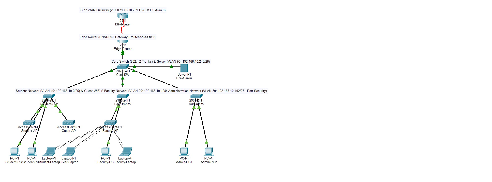

# Secure Wireless & Segmented Campus Network Architecture


An enterprise-grade network design and implementation simulating a modern, highly secure campus infrastructure built in Cisco Packet Tracer. The design emphasizes modular 3-tier hierarchical layout principles, 802.1Q VLAN segmentation, VLSM IPv4 address optimization, dynamic NAT/PAT edge translation, single-area OSPF routing, wireless access infrastructure, and multi-layered security engineering.

---

## 📐 Topology Architecture Diagram



---

## 🌟 Key Technical Features

- **Hierarchical Design**: Modular 3-tier architecture separating Core, Access, and WAN Edge layers.
- **Edge Routing & WAN Uplink**: Cisco 2911 Edge Router with PPP encapsulation over point-to-point serial WAN (`203.0.113.0/30`), configured with single-area OSPF (Area 0) and default outbound routing to the ISP.
- **Network Address Translation (NAT/PAT)**: Dynamic Port Address Translation (NAT Overload) on the WAN edge interface (`Serial0/0/0`) mapping internal private subnets (`192.168.10.0/24`) to public IPv4 endpoints.
- **Inter-VLAN Routing**: IEEE 802.1Q Router-on-a-Stick architecture using sub-interfaces on `GigabitEthernet0/0`.
- **Departmental Logical Segmentation**: 5 distinct 802.1Q VLANs isolating Students, Faculty, Administration, Guest Wireless, and Data Center Services.
- **Subnet Optimization (VLSM)**: Efficient address partitioning of parent network `192.168.10.0/24` with zero wasted address space.
- **Security Engineering**:
  - **Extended Access Control Lists (ACLs)**: Enforces network boundary isolation (blocking student access to administrative subnets and isolating guest traffic from internal resources).
  - **Layer 2 Port Security**: Configured on sensitive administrative access switchports with sticky MAC learning (`mac-address sticky`, `violation shutdown`).
  - **Device Hardening Baseline**: Encrypted enable secrets, `service password-encryption`, local database authentication, and customized legal MOTD banners.
- **Data Center Application Services**: Central server hosting DNS (`53/udp`), HTTP (`80/tcp`), and FTP (`21/tcp`).

---

## 📊 VLAN & VLSM Addressing Schema

**Base Network**: `192.168.10.0/24` (Partitioned into custom subnets using Variable Length Subnet Masking)

| Department / Zone | VLAN ID | Network Address | Subnet Mask | Usable Host Range | Default Gateway |
| :--- | :---: | :---: | :---: | :---: | :---: |
| **Student Zone** | `10` | `192.168.10.0/25` | `255.255.255.128` | `192.168.10.1` – `192.168.10.126` | `192.168.10.1` |
| **Faculty Zone** | `20` | `192.168.10.128/26` | `255.255.255.192` | `192.168.10.129` – `192.168.10.190` | `192.168.10.129` |
| **Admin Zone** | `30` | `192.168.10.192/27` | `255.255.255.224` | `192.168.10.193` – `192.168.10.222` | `192.168.10.193` |
| **Guest Wireless** | `40` | `192.168.10.224/28` | `255.255.255.240` | `192.168.10.225` – `192.168.10.238` | `192.168.10.225` |
| **Data Center / Services** | `50` | `192.168.10.240/28` | `255.255.255.240` | `192.168.10.241` – `192.168.10.254` | `192.168.10.241` |
| **WAN Link** | `N/A` | `203.0.113.0/30` | `255.255.255.252` | `203.0.113.1` – `203.0.113.2` | `203.0.113.1` |

---

## 🛠️ Infrastructure Inventory

| Component | Model | Quantity | Role |
| :--- | :--- | :---: | :--- |
| **Core & ISP Routers** | Cisco 2911 | 2 | Campus Edge Router & WAN Gateway |
| **Switches** | Cisco Catalyst 2960-24TT | 4 | 1x Core Switch, 3x Access Switches |
| **Access Points** | Autonomous AccessPoint-PT | 3 | Student, Faculty, and Guest Access Points |
| **Server** | Multi-service Server-PT | 1 | DNS, HTTP Web, and FTP Data Center Server |
| **End Devices** | PC & Laptop (Ethernet/WiFi) | 8 | Workstations and 802.11 Wireless Endpoints |

---

## 💻 Protocol Implementation Matrix

| Layer | Protocol | Technology / Purpose |
| :--- | :--- | :--- |
| **Layer 2 (Data Link)** | IEEE 802.3, 802.1Q, PPP, 802.11 | Ethernet Switching, VLAN Trunking, Point-to-Point WAN, Wi-Fi |
| **Layer 3 (Network)** | IPv4, VLSM, OSPFv2, NAT/PAT | Address Allocation, Dynamic Routing (Area 0), Address Translation |
| **Layer 4 (Transport)** | TCP, UDP | Connection-oriented & connectionless transport protocols |
| **Layer 7 (Application)** | DNS, HTTP, FTP, Telnet, SSH | Domain Resolution (`53`), Web (`80`), File Exchange (`21`), Management (`23/22`) |

---

## 🔒 Security Policy Enforcement

1. **Department Isolation via Extended Access Control Lists**:
   - `ACL-STUDENT`: Applied inbound on sub-interface `Gi0/0.10`. Permits internet/server access while dropping all traffic destined for `Admin-Zone` (`192.168.10.192/27`).
   - `ACL-GUEST`: Applied inbound on sub-interface `Gi0/0.40`. Permits DNS (`53/udp`) and HTTP (`80/tcp`) to the server and outbound WAN traffic while blocking lateral internal network traversal.
2. **Access Port Hardening**:
   - Configured sticky port security on administrative switch ports (`Admin-SW` `Fa0/1`) limiting access to authorized device MAC addresses with automatic shutdown violation mode.
3. **Control Plane Security**:
   - Encrypted executive passwords (`enable secret`), global credential hashing (`service password-encryption`), and customized MOTD login banners.

---

## ✅ Empirical Verification Summary

- **Inter-VLAN Connectivity**: Confirmed 0% packet loss for authorized traffic traversing 802.1Q sub-interfaces.
- **ACL Traffic Drops**: Verified unauthorized Student $\rightarrow$ Admin access attempts result in `Destination host unreachable` (100% drop).
- **NAT Overload Table**: Verified active translation entries (`icmp 203.0.113.2:20 -> 8.8.8.8:20`) mapping internal private hosts to public IP endpoints.
- **OSPF Neighbor State**: Confirmed OSPF neighbor state `FULL/-` across the serial link.
- **Application Layer Testing**: Confirmed DNS resolution (`nslookup univ.edu`), HTTP portal access, and authenticated FTP session listing (`230 User logged in`).

---

## 🚀 Getting Started

To explore or modify this architecture:

1. Clone this repository:
   ```bash
   git clone https://github.com/tzar-beep/College-campus-network.git
   ```
2. Open **Cisco Packet Tracer** (v8.0+ or v9.0+).
3. Open `Campus_Secure_Wireless_Network.pkt`.
